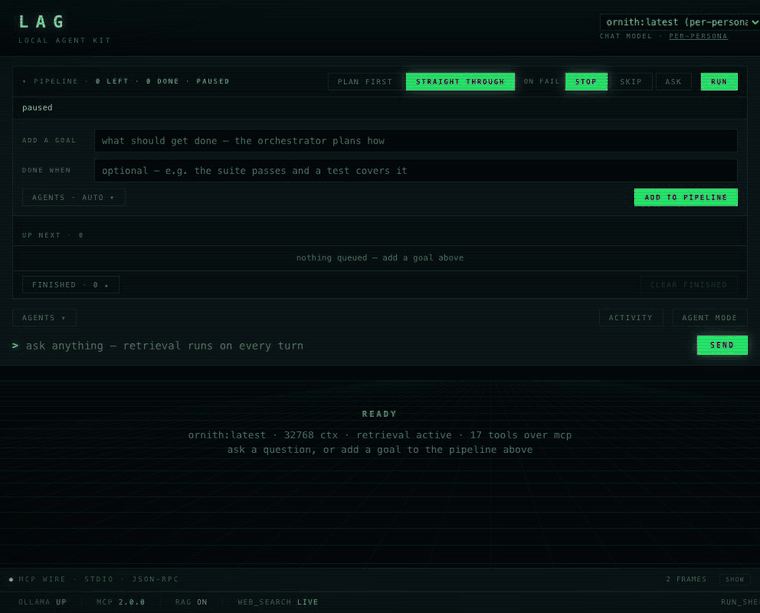

# local-agent-kit (`lag`)

A fully offline multi-agent harness over [Ollama](https://ollama.com). No cloud, no API
keys, no telemetry: the models, the tools and your data all stay on the machine.

Agents call tools over a real [Model Context Protocol](https://modelcontextprotocol.io)
boundary. The tools run as separate server processes, and retrieval is just one more MCP
server. Unattended work runs in a locked-down container with a filtering egress proxy.



## What it does

- **Goal queue.** Write what you want done in detail (be as detailed as possible) in the description, "done when" should should be ve very direct and clear, which is important to the agent so it has an obvious goal and stopping point.
  orchestrator reads each goal, picks which specialist agents should handle it, briefs them, and works through the queue one goal at a time. It runs on the server, so it keeps
 going with the browser closed. Agents decide rather than stall: an answer that ends on
a question is sent back to choose and finish. A goal only counts as done once its answer
  is checked against "done when". `lag goals` drives the same queue from the terminal.
- **Live console** (`lag serve`). Streams every stage's thinking, tool calls and answer
  as they happen. A separate activity window keeps the raw trace.
- **Pipelines** (`lag pipeline`). Staged agents, each seeing the work above it. The
  orchestrator can choose the stages itself or you can name them.
- **Agent mode** (`lag agent`). Saved agents that loop on a long-running goal, with
  circuit breakers for repeated failures and for agents that go idle.
- **Study mode** (`lag study`). Ask questions and get quizzed on your own course notes,
  with answers cited from the source.
- **Nine personas** (architect, dev, senior dev, tester, analyst, researcher and more),
  each a YAML file that names a role, not a model.

## Design decisions

The interesting parts of this project are the constraints it was built around, most of
them measured on the target machine (a 16 GB MacBook Air M4).

**One model at a time is the real limit.** It is free memory, not a setting: with macOS
and a browser open, the 16 GB Mac has about 9 GB free, which fits one chat model.
Loading a second evicted the first in every trial, and Ollama's log says why: the next
model is "predicted to exceed available memory" (`system_limited=true`), while GPU
memory still had room. Each switch is a cold load of 6–7.5s for a 9B model and
4–5s for `qwen3:8b`. So stages run in sequence, never in parallel (an
earlier parallel mode made concurrent agents evict each other in a loop), goals are a
queue rather than a pool, and routing and briefing happen in a single orchestrator call
instead of two. Pinning every stage to one model turns a three-load run into one.

**Thinking costs time; context size doesn't.** Generation speed was flat from 8K to 128K
context, so `num_ctx` is set for memory, not speed. Reasoning tokens were the cost: personas had a
thinking switch that never reached Ollama, and one meant to skip reasoning was spending up
to 2,600 thinking tokens. Wiring the switch through brought that to zero.

**A real MCP boundary, not a shim.** The first version faked tool calls over a direct
HTTP shim. Now tools live in their own processes, are discovered at runtime, and work
with any MCP client. The loop accepts anything with `schemas()` and `call()`, so the
in-process provider, the MCP bridge and the sandbox are wrappers that compose without
the loop knowing which are present.

**Retrieval is just a tool.** The RAG server exposes one `search_knowledge_base` tool.
To the agent it looks like any other call.

**Model capabilities are discovered, not hardcoded.** The harness asks Ollama whether a
model supports tools and thinking. A completion-only model runs without tools and says
so instead of failing.

**Unattended work is confined, and fails closed.** Agent mode and the goal queue run
shells in a Docker or Podman container:

- the project is mounted read-only, with one writable workspace
- all capabilities are dropped, and pids, memory and CPU are capped
- the only route out is a per-agent proxy on an internal network that allows the public
  internet but refuses the host, the LAN and the tailnet
- no container runtime means no run

## Architecture

```
        ┌─────────────────────┐
        │  Ollama (local LLM) │   one chat model resident at a time
        └──────────┬──────────┘
                   │  tools ↓   tool_calls ↑
        ┌──────────┴──────────┐        ┌────────────────────────────┐
        │  Harness  (lag)     │◄──────►│  Console  (lag serve)       │
        │  ReAct loop         │  SSE   │  goal queue · live stream   │
        │  pipeline · goals   │        └────────────────────────────┘
        │  agent mode         │
        └──────────┬──────────┘
                   │  stdio · JSON-RPC (MCP)       ┌──────────────────────────┐
        ┌──────────┴───────────────────────┐       │ Sandbox (unattended runs)│
        │  MCP servers (own processes)      │      │ container · ro project   │
        │   • tools_server  16 tools        │─────►│ egress proxy · fails     │
        │   • rag_server    knowledge base  │      │ closed without Docker    │
        └──────────────┬────────────────────┘      └──────────────────────────┘
                       ▼
           Chroma · nomic-embed-text
```

Each turn, the harness lists the servers' tools, translates their schemas into Ollama's
tool-calling format, sends the conversation, routes any `tool_calls` back over MCP, and
loops until the model answers.

## Quick start

Needs Python 3.12. Docker Desktop is needed for agent mode and the goal queue.

```bash
git clone https://github.com/Hinzmo/lag-kit.git && cd lag-kit
./install.sh                              # venv, Ollama, models, config.yaml
.venv/bin/lag serve                       # console at http://127.0.0.1:8765
```

`install.sh` builds the venv and runs `lag setup`, which installs Ollama if it is missing
(asking first), starts it, pulls `qwen3.5:9b` for every agent and `nomic-embed-text` for
retrieval, writes `config.yaml`, and indexes `docs/` into the knowledge base. One model
for every role means a run loads it once and never switches.

**Switching models is one command.** Local models move fast, so nothing is pinned:

```bash
lag setup --model qwen3:14b               # pull it and map the agents to it
lag setup --orchestrator gemma4:e4b      # same for the planning role
lag models                                # what's installed, what it supports, who uses it
```

Re-running `lag setup` with no flags keeps your mapping and pulls anything it names that
is missing. Use Python 3.12: Homebrew's current `python3` is 3.14, and `chromadb` has no
3.14 wheel yet. Run `lag` from the repo root, because its state folders are relative to the
working directory.

## Commands

```bash
lag setup                                 # install Ollama, pull models, write config
lag models                                # installed models and the roles using them
lag run "what is this project?"           # one agent, local tools
lag run "same thing" --mcp                # same tools, over the MCP boundary
lag pipeline "design a url shortener"     # staged agents
lag serve                                 # web console and goal queue
lag serve --phone-port 8766               # plus a key-only port for the phone app
lag phone pair                            # QR code + one-time code; then: devices | revoke
lag goals add "…" --done-when "…"         # then: ls | run | watch | show | pause | skip | rm
lag agent new                             # then: list | start | status | stop
lag study add <course> <path>             # then: ask | quiz | cards | review
```

## Models

Bring your own. Personas name a role, and `config.yaml` maps each role to any model from
your `ollama list`. Nothing is hardcoded: the console's model picker reads your installed
models live from Ollama, and asks each one whether it supports tools and thinking.

`lag setup` defaults every chat role to **`qwen3.5:9b`**, plus `nomic-embed-text` for
retrieval. One model for every role means one load per run. It was picked from a
five-model run on the 16 GB M4, every model on the kit's real 16 tools at 8K context:

| Model | Engine | Generate | Prefill | Resident | Tool picks | Two real goals |
|---|---|---:|---:|---:|---:|---|
| `gemma4:e4b` | MLX | 34.8 tok/s | 324 tok/s | 9.4 GB | 6/7 | both right · 40 s, 57 s |
| `qwen3.5:9b` | MLX | 18.6 tok/s | 121 tok/s | 7.7 GB | 7/7 | both right · 68 s, 104 s |
| `ornith:latest` | llama.cpp | 18.1 tok/s | 143 tok/s | 4.7 GB | 6/7 | both right · 61 s, 102 s |
| `qwen3:8b` | llama.cpp | 15.2 tok/s | 118 tok/s | 5.8 GB | 7/7 | both right · 81 s, 134 s |

The goals were questions about this repo, answered by one agent reading the files and
graded against the source. On Apple Silicon, Ollama serves `qwen3.5:9b` and `gemma4:e4b`
as MLX builds automatically. A plain 4-bit MLX build of Qwen was the slowest model in the
run (14.8 tok/s), so MLX alone is not the speed-up.

Gemma 4 is about twice as fast but holds 9.4 GB whatever the context, which is the whole
free budget on a 16 GB Mac with a browser open. Use it with memory to spare:

```bash
lag setup --model gemma4:e4b --orchestrator gemma4:e4b   # everything on Gemma 4
lag setup --model qwen3:8b --orchestrator qwen3:8b       # smaller, for tighter machines
```

Pick models that support tools (`lag models` shows which do).

## Security notes

- **Supervised runs are not sandboxed.** `lag run` and `lag pipeline` use the host shell,
  by design, on a single-user machine. Only unattended work (agent mode and goals) is
  confined.
- **Two tools reach the internet:** `web_search` (keyless DuckDuckGo) and `http_fetch`.
  `http_fetch` only allows public addresses and re-checks every redirect.
- **Sandboxed agents reach the public internet by default**, through the proxy. Create
  an agent with `--no-network` to seal it.
- **The console answers only to names it knows.** `lag serve` serves `localhost`,
  `127.0.0.1`, `::1` and its bind address, and refuses any POST whose `Origin` is another
  site. That keeps other web pages out, including by DNS rebinding. To reach it by
  another name, such as a tailnet name, add `--allow-host NAME`.
- **Phones get a port of their own.** `lag serve --phone-port 8766` listens on 127.0.0.1
  for `tailscale serve` to forward to. Every request there needs a device key from
  `lag phone pair` (stored on the Mac only as a hash; `lag phone revoke` cuts a phone off),
  and chats from a phone run in the same sandbox as goals.
- **Model output is shown as text.** Answers, tool names and agent names are escaped
  before the console renders them, because a fetched page can steer what a model writes.

## Tests

Over 500 tests: the loop, the MCP bridge, the sandbox and egress proxy (with real containers
when Docker is running), the goal queue, and the console. The console is checked in jsdom.

```bash
.venv/bin/pip install -e ".[dev]"     # pytest, httpx, ruff
.venv/bin/python -m pytest
cd tests/js && npm install                # enables the console tests
```

Clients (the console, `lag goals`, the phone app) build on a written API contract:
[`docs/api-contract.md`](docs/api-contract.md). `tests/test_contract.py` keeps it, the
recorded example streams and the server in step.

`STATUS.md` has the full current state, measurements and what's left.

## License

MIT. See [LICENSE](LICENSE).
